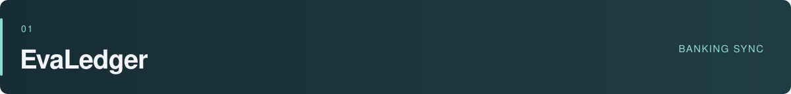

<picture>
  <source media="(prefers-color-scheme: dark)" srcset="assets/profile-dark.svg">
  
</picture>

  <a href="https://www.linkedin.com/in/burakbilgen">LinkedIn</a> &nbsp; / &nbsp;
  <a href="mailto:bilgenburak@outlook.com">Email</a> &nbsp; / &nbsp;
  <a href="https://github.com/burak-bilgen?tab=repositories">Repositories</a>

I'm Burak, an iOS developer with a background in **fintech and cryptocurrency**. I work mostly in Swift, SwiftUI, and UIKit. Outside work, I build my own apps for iPhone and Mac, and lately I've been making games too.

These repos cover different things I enjoy working on: payment handling, local storage, desktop integrations, and game logic. A few are ready to download; others are still in development.

## Selected projects

A banking demo focused on what happens when a payment request times out or the app closes before getting an answer.

The app saves each attempt before sending it, keeps unconfirmed payments across launches, and checks them against the bank's transaction feed. Retries use the same idempotency key. The tests use a fake bank to reproduce lost responses, duplicate entries, and crashes during a payment.

`SwiftUI` `Actors` `Swift Testing`

[Repository ↗](https://github.com/burak-bilgen/EvaLedger) &nbsp; · &nbsp; [Payment engine](https://github.com/burak-bilgen/EvaLedger/blob/main/EvaLedger/Core/Engine/PaymentEngine.swift) &nbsp; · &nbsp; [Recovery tests](https://github.com/burak-bilgen/EvaLedger/blob/main/EvaLedgerTests/Scenarios/Scenario4KilledMidFlightTests.swift)

 

An offline iPhone game about buying, fixing, and selling secondhand items. You inspect what you've bought, decide which repairs are worth paying for, and negotiate with buyers.

I built the simulation separately from the SwiftUI screens. It handles prices, repairs, buyers, and events that progress while you're away. Saves are validated when loaded, with backups and recovery for damaged files. The game supports six languages, Dynamic Type, and Reduce Motion.

`Swift 6` `SwiftUI` `Simulation` `Local persistence`

[Repository ↗](https://github.com/burak-bilgen/GoodFindGame) &nbsp; · &nbsp; [Simulation code](https://github.com/burak-bilgen/GoodFindGame/tree/main/ProjectFlip/Simulation) &nbsp; · &nbsp; [Save system](https://github.com/burak-bilgen/GoodFindGame/tree/main/ProjectFlip/Persistence)

In development · iOS 26+ · Not yet on the App Store

  

A Mac app for controlling music from the menu bar or the edges of your screen. It also has a draggable mini player and a full-screen ambient mode.

Much of the work is in the macOS details: talking to music players, handling Automation permissions, keeping playback information up to date, and showing controls without taking focus from another app. Available as a direct download and through Homebrew.

`Swift` `SwiftUI` `AppKit` `AppleScript`

[Repository ↗](https://github.com/burak-bilgen/Songleton) &nbsp; · &nbsp; [Download](https://github.com/burak-bilgen/Songleton/releases/latest) &nbsp; · &nbsp; [Player integration](https://github.com/burak-bilgen/Songleton/blob/main/Songleton/Domain/Playback/MediaController.swift)

## Other projects

| Project | About |
| :--- | :--- |
| **[Vade](https://github.com/burak-bilgen/Vade)** | Debt tracking across currencies and physical gold. Built with modular Swift packages, SwiftData, and CloudKit. |
| **[ForeWiz](https://github.com/burak-bilgen/ForeWiz)** | Weather-based activity suggestions and route planning using WeatherKit and MapKit. |
| **[DeFilms](https://github.com/burak-bilgen/DeFilms)** | Movie discovery with on-device recommendations and support for English, Turkish, and Arabic. |
| **[NewsApto](https://github.com/burak-bilgen/NewsApto)** | A news reader that combines multiple sources, ranks articles, and saves them for offline reading. |
| **[Project Asahi](https://github.com/burak-bilgen/Project-Asahi)** | A game project in Godot and GDScript, with save, time, job, and progression systems. |

## How I work

I like keeping business logic separate from UI code so I can test it without driving a screen. For async work, I pay particular attention to what happens when a request fails, finishes late, or gets interrupted.

I also spend time on the less visible parts of an app: save migrations, permission handling, accessibility, and localization. They're easy to put off, but they affect whether an app is comfortable to use every day.

---

For iOS roles, freelance work, or questions about these projects, you can reach me at **[bilgenburak@outlook.com](mailto:bilgenburak@outlook.com)** or on **[LinkedIn](https://www.linkedin.com/in/burakbilgen)**.
