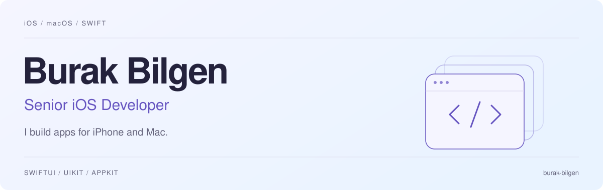
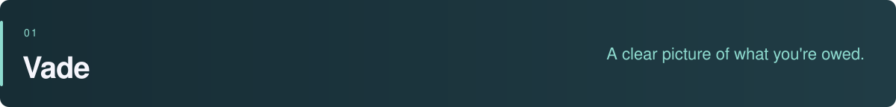
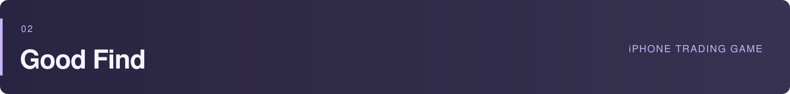
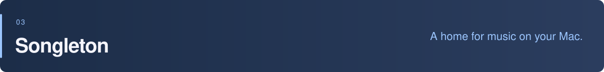

<picture>
  <source media="(prefers-color-scheme: dark)" srcset="assets/profile-dark.svg">
  
</picture>

  <a href="https://www.linkedin.com/in/burakbilgen">LinkedIn</a> &nbsp; / &nbsp;
  <a href="mailto:bilgenburak@outlook.com">Email</a> &nbsp; / &nbsp;
  <a href="https://github.com/burak-bilgen?tab=repositories">Repositories</a>

I'm Burak, an iOS developer with a background in **fintech and cryptocurrency**. I work mostly in Swift, SwiftUI, and UIKit. Outside work, I build my own apps for iPhone and Mac, and lately I've been making games too.

These repos cover different things I enjoy working on: payment handling, local storage, desktop integrations, and game logic. A few are ready to download; others are still in development.

## Selected projects

Lending money gets harder to keep track of when one debt is in lira, another is in dollars, and someone owes you gold. **Vade** keeps debts and receivables together, with payment history, due-date reminders, and exchange rates from Turkey's central bank.

It works offline and syncs through your private iCloud database. I split the app into Swift packages for domain logic, data, networking, the design system, and individual features. SwiftData handles local storage; CloudKit handles sync. Biometric locking, an audit trail, home-screen widgets, and PDF/CSV exports round out the app.

`Swift 6` `SwiftUI` `SwiftData` `CloudKit` `Modular SPM`

[Repository ↗](https://github.com/burak-bilgen/Vade) &nbsp; · &nbsp; [Screenshots & architecture](https://github.com/burak-bilgen/Vade#readme)

 

A cheap listing isn't always a bargain. In **Good Find: Buy, Fix & Sell**, you build a secondhand trading business by checking items, uncovering faults, choosing repairs, and negotiating a resale. The final receipt tells you whether the deal was actually worth it.

The market changes as you play, with competing traders, returning clients, and a separate Weekly Flip challenge.

I built the simulation separately from the SwiftUI screens. It handles prices, repairs, buyers, and events that progress while you're away. Saves are validated when loaded, with backups and recovery for damaged files. The game supports six languages, Dynamic Type, and Reduce Motion.

`Swift 6` `SwiftUI` `Simulation` `Local persistence`

[Repository ↗](https://github.com/burak-bilgen/GoodFindGame) &nbsp; · &nbsp; [Simulation code](https://github.com/burak-bilgen/GoodFindGame/tree/main/ProjectFlip/Simulation) &nbsp; · &nbsp; [Save system](https://github.com/burak-bilgen/GoodFindGame/tree/main/ProjectFlip/Persistence)

In development · iOS 26+ · Not yet on the App Store

  

**Songleton** brings playback into the places you already use on your Mac: the menu bar, the edge of the screen, or a small player on your desktop. Change tracks with a screen-edge gesture, snap the mini player into place, or open Ambient Mode for album artwork and synchronized lyrics.

It controls your existing music player, so there's no separate library to manage or account to create.

Much of the work is in the macOS details: talking to music players, handling Automation permissions, keeping playback information up to date, and showing controls without taking focus from another app. Available as a direct download and through Homebrew.

`Swift` `SwiftUI` `AppKit` `AppleScript`

[Repository ↗](https://github.com/burak-bilgen/Songleton) &nbsp; · &nbsp; [Download](https://github.com/burak-bilgen/Songleton/releases/latest) &nbsp; · &nbsp; [Player integration](https://github.com/burak-bilgen/Songleton/blob/main/Songleton/Domain/Playback/MediaController.swift)

## Other projects

### [EvaLedger](https://github.com/burak-bilgen/EvaLedger) · What happens after a payment times out?

A banking demo built around a difficult distinction: a missing response doesn't tell you whether the money moved. EvaLedger saves payment attempts before sending them, recovers interrupted attempts after relaunch, and reconciles them with the bank's transaction feed. An injectable fake bank reproduces lost responses, duplicate entries, and late rejections in scenario tests.

[Payment engine](https://github.com/burak-bilgen/EvaLedger/blob/main/EvaLedger/Core/Engine/PaymentEngine.swift) · [Recovery tests](https://github.com/burak-bilgen/EvaLedger/blob/main/EvaLedgerTests/Scenarios/Scenario4KilledMidFlightTests.swift)

### [ForeWiz](https://github.com/burak-bilgen/ForeWiz) · Plan around the weather

A forecast is more useful when it helps you choose when to leave or what to wear. ForeWiz uses WeatherKit data to suggest activities, clothing, and suitable times to head outside. Its WizPath package adds MapKit routes with weather along the journey and departure-time comparisons. The scoring and planning logic is kept separate from the interface for testing.

### [DeFilms](https://github.com/burak-bilgen/DeFilms) · Find a film you're in the mood for

Movie discovery with TMDB, personal lists, and on-device recommendations through Apple Foundation Models. I paid attention to the details around browsing: search results arriving out of order, paginated feeds, and navigation between films and lists. It supports English, Turkish, and Arabic, including right-to-left layouts, with a fallback when the on-device model isn't available.

### [NewsApto](https://github.com/burak-bilgen/NewsApto) · Your reading, across sources

A news reader that brings six sources into one feed, removes duplicate stories, and ranks articles by factors such as recency and source authority. Each provider has its own adapter, so networking and source-specific formats stay out of the UI. Saved articles remain available offline. Built with Apple frameworks and a terminal-inspired interface.

### [Project Asahi](https://github.com/burak-bilgen/Project-Asahi) · Starting over in a small town

A Godot and GDScript game in development about leaving the city and building a life in a remote town. The idea is to make ordinary choices matter: which job to take, how to spend the day, and what to improve at home. The current project separates time, jobs, progression, and saving into their own systems. It's also where I'm exploring game development outside Swift.

## How I work

I like keeping business logic separate from UI code so I can test it without driving a screen. For async work, I pay particular attention to what happens when a request fails, finishes late, or gets interrupted.

I also spend time on the less visible parts of an app: save migrations, permission handling, accessibility, and localization. They're easy to put off, but they affect whether an app is comfortable to use every day.

---

For iOS roles, freelance work, or questions about these projects, you can reach me at **[bilgenburak@outlook.com](mailto:bilgenburak@outlook.com)** or on **[LinkedIn](https://www.linkedin.com/in/burakbilgen)**.
